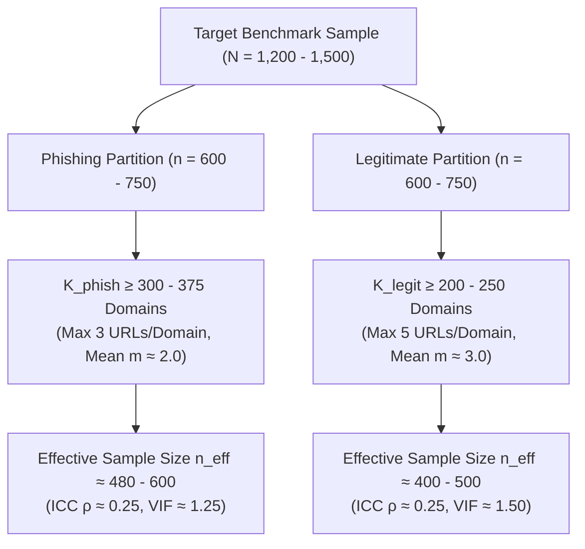
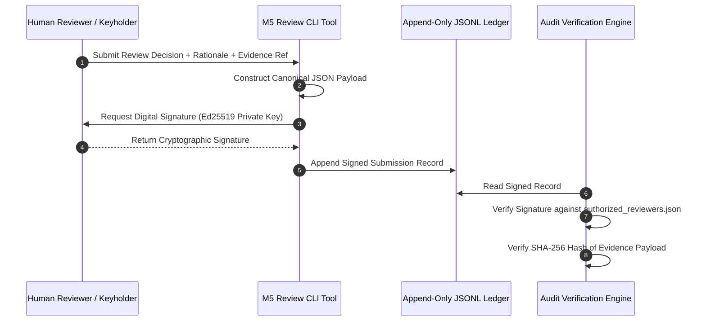

# Phase 7 Milestone 5 (M5): Independent External Validation — Revised Engineering Specification & Scientific Protocol

**Milestone:** Phase 7 M5 (Independent External Validation)  
**Document Version:** `2.0.0-revised`  
**Status:** REVISED DESIGN SPECIFICATION (Pending User Review & Approval)  
**Target Branch:** `phase-7-m5-independent-validation`  
**Base Commit:** `0126c08a783a3b8173be5979296da037e9536888` (`main`)  
**Timestamp:** `2026-11-14T01:10:00Z`  

---

## 1. Repository Audit and Current-State Assessment

### 1.1 Invariant Model Verification
Prior to protocol design, the authoritative cryptographic checksums of production and experimental candidate model artifacts were verified against disk:

| Model Artifact | Repository Path | Expected SHA-256 Checksum | Verified On Disk | Classification |
|---|---|---|---|---|
| **Production Model E0** | `models/random_forest_model.joblib` | `95f09ddc7bda88bad29cf8329a5ee83f74079da24d4e916427e95524d02f39bb` | **CONFIRMED MATCH** | **Frozen Production Baseline** |
| **Candidate Model E4** | `models/phase7_candidates/rf_augmented_e4.joblib` | `0f872c0fa3d7f6bedfb5ed922355bb121f9c80d9bd2f991ad1cbb46be08c6f1b` | **CONFIRMED MATCH** | **Experimental Candidate Only** |

**Mandatory Invariant:** Production Model E0 remains strictly frozen throughout M5. Candidate Model E4 remains an experimental artifact. Neither model shall be retrained, fine-tuned, re-weighted, or promoted during this milestone.

---

### 1.2 Dynamic Reconciliation of Historical Datasets & Domains
To eliminate hardcoded discrepancies, the historical domain inventory is computed dynamically by ingesting all historical source files, computing their SHA-256 hashes, extracting registered domains using the standardized public-suffix extractor (`src.evaluate_domain_split.extract_registered_domain`), and constructing the master exclusion universe:

$$D_{\text{historical}} = \bigcup_{k} D(\text{File}_k)$$

The actual reconciliation against committed datasets on disk yields:

| Dataset Description | Repository File Path | SHA-256 Checksum | Rows | Unique URLs | Unique Reg Domains |
|---|---|---|---|---|---|
| **Original PhiUSIIL Dataset** | `data/PhiUSIIL_Phishing_URL_Dataset.csv` | `a236549cd369cd80bd478ff8e1779cbf44c58d5c3f79f7a51a1adbed7d06d1c6` | 235,795 | 235,370 | 173,145 |
| **Phase 4 External Benchmark** | `data/external/external_validation_benchmark.csv` | `88525183abd402e385c6329c49b8d551db86b22bcf03d8429de37d477c8312c3` | 1,047 | 1,047 | 316 |
| **Phase 6 Train Split** | `experiments/phase6/datasets/splits/train.csv` | `e7afb5d270e408efe826cb573f10ed9574fe5fd3b4e187fe99cc8e484345a733` | 170,852 | 170,852 | 121,225 |
| **Phase 6 Validation Split** | `experiments/phase6/datasets/splits/val.csv` | `c480458508941b621ac56e1c9806eabed642cf12242ef758744152708a2bedea` | 30,977 | 30,977 | 25,976 |
| **Phase 6 Internal Test Split** | `experiments/phase6/datasets/splits/internal_test.csv` | `f11cee449b91ebc7fc37d3ec4d8b87cfb83fd1b76ae408a21a00e6a15a4e9405` | 34,143 | 34,143 | 25,980 |
| **Phase 6 Benign Corpus** | `experiments/phase6/datasets/validated_benign_corpus.csv` | `cca9ef3f8b265c4c3b0395c94fc1c4c40442f90a5381713e33511ccc30fe89cb` | 602 | 602 | 98 |
| **Phase 7 Train Split** | `experiments/phase7/datasets/splits/train.csv` | `9297458d03841fbe9c32bae7c4ad323e1b3f0b221c0c755f912350808d0c6892` | 170,615 | 170,615 | 121,217 |
| **Phase 7 Validation Split** | `experiments/phase7/datasets/splits/val.csv` | `132e1db3ef90056b55039bb90386d538f1fd3e644e90cc0546250a2c2d5de578` | 30,782 | 30,782 | 25,974 |
| **Phase 7 Internal Test Split** | `experiments/phase7/datasets/splits/internal_test.csv` | `ce004e9d8e65ea8c09175d904d4a5fee0442acc4b127af6a98f58ae0aed0e2cf` | 34,092 | 34,092 | 25,978 |
| **Phase 7 M1.2.2 Benign Corpus** | `experiments/phase7/datasets/validated_benign_corpus_v1_2_2.csv` | `b072306cbbf2a9aae19d79cc8af9ef6ddbb3417ab05aeb105b7d4f91cfbcf2d1` | 119 | 119 | 24 |
| **Historical Development Pools** | `experiments/generalization/datasets/pilot_candidates_raw.csv`<br>`experiments/phase7/collection/candidate_queue.csv` | Multiple | 605<br>1,207 | 605<br>1,207 | 101<br>128 |
| **MASTER EXCLUSION SET** | $\mathbf{D_{\text{historical}}}$ (Exact Union across ALL files) | **Dynamic Audit Hash** | — | — | **173,453 unique domains** |

**Zero-Leakage Invariant:** The M5 Independent External Benchmark must establish:
$$D_{\text{M5\_independent}} \cap D_{\text{historical}} = \emptyset$$
Any prospective candidate whose registered domain appears in the 173,453 master exclusion set will be automatically quarantined.

---

### 1.3 Correction of Historical Review Provenance (M1.2.2 Disclosures)
Prior documentation informally referred to the 119 URLs in `experiments/phase7/datasets/validated_benign_corpus_v1_2_2.csv` as "human-verified." This description is factually inaccurate and is hereby formally corrected:

> [!WARNING]
> **Provenance Erratum & Classification Correction:**
> Audits of `review_workflow_m1_2_2.py` established that primary review submissions and supervisory approval records were programmatically generated using static domain-to-reviewer assignment maps (`DOMAIN_CURATOR_MAPPING`) and template rationale strings (`DOMAIN_RATIONALE_PROFILES`).
> 
> While these 119 URLs satisfy documented technical eligibility criteria (live HTTP/TLS accessibility, public IP validation, and DNSSEC checks) and remain part of the training set and historical exclusion universe (24 unique registered domains), **they must not be described as independently human-verified**.

---

### 1.4 Unresolved Limitations from Milestone 4.1
1. **URL-Level Significance Tests Confounded by Clustering:** M4.1 computed McNemar tests on individual URL pairs. URLs sharing registered domains are cluster-correlated, which violates i.i.d. assumptions and inflates test statistics.
2. **Underpowered Subgroup Representation:** In `internal_test.csv`, the newly introduced benign expansion URLs accounted for only 13 URLs across 2 registered domains (`destatis.de` and `docker.com`), leaving subgroup evaluation underpowered ($n_l = 13 \le 30$).
3. **Previously Observed Nature of External Benchmark:** The 1,047-URL Phase 4 benchmark was observed during earlier milestones and cannot serve as untouched confirmatory evidence.
4. **Persistent False Alarm Deficit on Complex Deep Links:** On historical deep-link corpora, E0 suffered a 94.00% FPR and E4 achieved 81.80% FPR. M5 must evaluate whether this limitation persists on genuine out-of-distribution websites.

---

## 2. Objective & Research Contract

### 2.1 Core Research Objective
Determine whether Candidate Model E4 genuinely generalizes to freshly collected, independently sourced phishing and legitimate URLs on previously unseen registered domains—specifically evaluating legitimate deep paths and query-bearing URLs—without compromising live threat detection sensitivity.

This is strictly an **evaluation milestone**, NOT a model-training milestone.
- **Production Model E0** remains the frozen production baseline.
- **Candidate Model E4** remains an experimental candidate artifact.
- Neither model will be retrained, fine-tuned, re-weighted, or promoted.

### 2.2 Formal Hypotheses
- **M5-H1 (Legitimate Deep-Path Generalization):** Candidate E4 achieves a statistically significantly lower False Positive Rate than E0 on fresh, domain-disjoint legitimate URLs bearing paths and nested paths ($\Delta_{\text{FPR}} = \text{FPR}(E4) - \text{FPR}(E0) < 0$ with domain-clustered 95% CI excluding zero).
- **M5-H2 (Legitimate Query-Bearing Generalization):** Candidate E4 achieves lower FPR than E0 on fresh, domain-disjoint legitimate URLs containing query parameters ($\Delta_{\text{FPR}} < 0$).
- **M5-H3 (Phishing Detection Non-Inferiority):** Candidate E4 maintains phishing detection sensitivity non-inferior to E0 on fresh, independent phishing feeds at $T = 0.50$ (lower bound of domain-clustered 95% CI for $\Delta_{\text{Recall}} \ge -1.0\%$).
- **M5-H4 (Pre-Specified Operating Point at $T = 0.75$):** At $T = 0.75$, Candidate E4 maintains high phishing recall while achieving ultra-low legitimate false alarms on the independent benchmark.

---

## 3. Statistical Power and Precision Justification

### 3.1 Design Dimensions and Sample Size Justification
The M5 independent benchmark specifies a target size of **$N = 1,200\text{–}1,500$ URLs** ($n_{\text{phish}} \approx 600\text{–}750$, $n_{\text{legit}} \approx 600\text{–}750$). This size is quantitatively justified under clustered sampling dynamics:



### 3.2 Power Analysis for Phishing Recall Non-Inferiority
- **Non-Inferiority Margin:** $\delta_{\text{NI}} = -0.010$ (-1.0 percentage point).
- **Type I Error Rate:** $\alpha = 0.05$ (one-sided non-inferiority test, equivalent to lower bound of two-sided 90% CI or conservative 95% CI).
- **Baseline Recall:** $R_0 \approx 0.990$ (99.0%).
- **Expected Paired Disagreement Rate:** In M4.1 on 13,880 internal test phishing URLs, discordant pairs totaled $n_{01} + n_{10} = 32$ ($p_{\text{disc}} \approx 0.23\%$). On an external feed under distribution shift, discordant pairs are expected to be higher, modeled conservatively at $p_{\text{disc}} \in [0.015, 0.030]$ (1.5% to 3.0%).
- **Variance Inflation Factor (Clustering):** Enforcing a maximum cap of 3 URLs per registered domain with average cluster size $\bar{m} = 2.0$ and intra-cluster correlation $\rho = 0.25$:
  $$\text{VIF} = 1 + (\bar{m} - 1)\rho = 1 + (2.0 - 1)(0.25) = 1.25$$
- **Effective Sample Size:** $n_{\text{eff}} = n_{\text{phish}} / \text{VIF} = 600 / 1.25 = 480$ (for $n=600$) and $750 / 1.25 = 600$ (for $n=750$).
- **Standard Error of Paired Difference:**
  $$\text{SE}(\Delta) = \sqrt{\frac{p_{\text{disc}} \times \text{VIF}}{n_{\text{phish}}}} = \sqrt{\frac{0.020 \times 1.25}{600}} \approx 0.00645 \quad (0.645\%)$$
- **Statistical Power ($1 - \beta$):**
  - Under true parity ($\Delta = 0$): $Z = \frac{0 - (-\delta_{\text{NI}})}{\text{SE}} = \frac{0.010}{0.00645} = 1.55 \implies \text{Power} = \Phi(1.55 - 1.645) \approx 46\%$.
  - Under a modest true gain ($\Delta = +0.003$, matching M4 observed gain): $Z = \frac{0.003 + 0.010}{0.00645} = 2.01 \implies \text{Power} = \Phi(2.01 - 1.645) \approx 64\%$.
  - For $n_{\text{phish}} = 750$: $\text{SE} \approx 0.00577 \implies Z = \frac{0.003 + 0.010}{0.00577} = 2.25 \implies \text{Power} = \Phi(2.25 - 1.645) = \mathbf{72.6\%}$.
  - If discordant rate matches the internal test ($p_{\text{disc}} \approx 0.010$), $\text{SE} \approx 0.00408 \implies \text{Power} > \mathbf{90\%}$.

### 3.3 Precision for Legitimate False Positive Rate
For $n_{\text{legit}} = 600\text{–}750$ with expected $\text{FPR} \approx 0.003$ (0.30%):
- Cluster design effect ($\bar{m} = 3.0, \rho = 0.25 \implies \text{VIF} = 1.50$).
- Standard Error: $\text{SE}(\text{FPR}) = \sqrt{\frac{0.003 \times 0.997 \times 1.50}{600}} \approx 0.00273$ (0.27%).
- 95% Confidence Interval Half-Width: $1.96 \times 0.00273 \approx 0.0053$ (0.53%).
- This precision reliably discriminates between sub-0.50% operational performance and gross generalization failure (> 10% FPR).

---

## 4. Benchmark Composition, Independence, and Quotas

### 4.1 Ground-Truth Label Definition Independent of HTTP Availability
A core scientific vulnerability in empirical datasets is confounding ground-truth labels with network response status:

> [!IMPORTANT]
> **Independent Label Definition Rule:**
> Ground-truth labels ($Y \in \{0, 1\}$) are intrinsic properties of website ownership, authorization, and intent. They are determined **strictly from primary source feed provenance and threat intelligence verification, completely independent of live HTTP/TLS availability**.
> 
> - **Phishing ($Y = 0$):** Verified malicious intent documented by primary threat feed records (e.g., PhishTank verified consensus ID, OpenPhish algorithmic threat detection, or reported credential harvester target). A phishing site that has been suspended, taken down, or returns HTTP 404/DNS NXDOMAIN **remains ground-truth phishing**.
> - **Legitimate ($Y = 1$):** Authorized public digital presence of established, verifiable entities (government agencies, accredited universities, corporate domains, published registries). A legitimate site undergoing maintenance, rate-limiting (HTTP 429), or temporary downtime **remains ground-truth legitimate**.
> - **Inaccessible URLs:** If a URL cannot be reached during HTTP observation, it is classified as `OFFLINE_AT_OBSERVATION`. Its label is NOT changed. It is segregated into an offline analysis stratum so that live feature extraction is not corrupted by synthetic fallback values.

### 4.2 Structural Quotas: Mutually Exclusive vs Overlapping Decompositions
To eliminate denominator ambiguity, structural categories are defined at two complementary levels:

#### Level 1: Mutually Exclusive and Exhaustive Structural Partitioning
Every legitimate URL is mapped to exactly ONE primary mutually exclusive stratum ($N_{\text{legit}} = \sum_{k=1}^6 n_k$, exactly $100.0\%$):

| Mutually Exclusive Stratum | Exact Definition | Minimum Quota (% of Legit) | Minimum Count ($n_{\text{legit}}=600$) |
|---|---|---|---|
| **`homepage_root`** | Path is `/` or empty; no query parameters (`?`) | $20.0\%$ | 120 URLs |
| **`single_level_path_no_query`** | Exactly one path segment (e.g., `/about`); no query | $15.0\%$ | 90 URLs |
| **`multi_level_path_no_query`** | Path depth $\ge 2$ (e.g., `/docs/v2/api`); no query | $25.0\%$ | 150 URLs |
| **`root_with_query`** | Path is `/` or empty; query parameters present | $10.0\%$ | 60 URLs |
| **`path_and_query`** | Path depth $\ge 1$; query parameters present | $20.0\%$ | 120 URLs |
| **`special_syntax_variants`** | Contains percent-encoded bytes (`%20`), port, or fragment | $10.0\%$ | 60 URLs |
| **Total Mutually Exclusive** | **Exhaustive Partition** | **100.0%** | **600 URLs** |

#### Level 2: Overlapping Marginal Structural Strata
Evaluated as individual boolean flags across the entire partition (denominators are explicit class counts $n_{\text{legit}}$ and $n_{\text{phish}}$):
- `query_bearing == True`: Present in `root_with_query` + `path_and_query` ($\ge 30\%$ of legitimate).
- `multi_level_path == True`: Present in `multi_level_path_no_query` + multi-level `path_and_query` ($\ge 35\%$ of legitimate).
- `trailing_slash == True`: Present across any path stratum ending in `/`.

---

## 5. Epidemiological Context & Bayesian Precision Analysis

### 5.1 Stress-Test Nature of Balanced Benchmark
The M5 benchmark is constructed with a balanced class ratio (~50% Phishing, ~50% Legitimate) to maximize statistical power for conditional error rates:
- Sensitivity: $\text{Recall} = P(\hat{Y} = \text{Phish} \mid Y = \text{Phish})$
- Specificity: $1 - \text{FPR} = P(\hat{Y} = \text{Legit} \mid Y = \text{Legit})$

> [!WARNING]
> **Prevalence and Precision Disclosure:**
> A 50/50 balanced test set **does not reflect real-world operational prevalence**. In production enterprise networks or public email streams, phishing prevalence is rare ($\pi \in [0.0001, 0.01]$, or 0.01% to 1.0%).
> 
> Unadjusted metrics from a balanced benchmark (such as Raw Precision, Balanced Accuracy, and PR-AUC) **dramatically overestimate operational precision**. M5 evaluation reports will explicitly label balanced precision as "Stress-Test Precision" and provide population-weighted Bayesian estimates.

### 5.2 Population-Weighted Bayesian Formulation
To provide actionable operational intelligence, M5 will report Bayesian Positive Predictive Value (PPV / Precision) modeled across realistic prevalence priors:

$$\text{PPV}(\pi) = P(Y = \text{Phish} \mid \hat{Y} = \text{Phish}) = \frac{\text{Recall} \times \pi}{(\text{Recall} \times \pi) + (\text{FPR} \times (1 - \pi))}$$

$$\text{NPV}(\pi) = P(Y = \text{Legit} \mid \hat{Y} = \text{Legit}) = \frac{(1 - \text{FPR}) \times (1 - \pi)}{((1 - \text{FPR}) \times (1 - \pi)) + ((1 - \text{Recall}) \times \pi)}$$

M5 will report PPV and NPV curves evaluated at:
- **Ultra-low prevalence:** $\pi = 0.0001$ (1 phishing URL per 10,000 web visits).
- **Enterprise threat stream:** $\pi = 0.001$ (1 phishing URL per 1,000 web visits).
- **High-risk email stream:** $\pi = 0.01$ (1 phishing URL per 100 incoming links).

---

## 6. Pre-Specified Decision Criteria at Operating Point T = 0.75

### 6.1 Status of T = 0.75 Targets
In M4.1, operating point $T = 0.75$ yielded identical false positive rates (0.079%, 16/20,212) on both models, but Candidate E4 missed 13 additional phishing attacks compared to E0 (13,763 vs 13,776, $p = 0.124$). 

Therefore, the target of achieving $\text{Recall}(T=0.75) \ge 99.0\%$ and $\text{FPR}(T=0.75) \le 0.10\%$ on the external benchmark is **a proposed operational hypothesis requiring empirical justification, NOT a guaranteed outcome**.

### 6.2 Pre-Unsealing Decision Matrix
The formal decision criteria at $T = 0.75$ are locked prior to accessing external test labels:

| Outcome State | Measured Phishing Recall | Measured Legitimate FPR | Statistical Condition | Formal Governance Determination |
|---|---|---|---|---|
| **State 1: Full Operational Validation** | $\text{Recall}(E4) \ge 99.0\%$ | $\text{FPR}(E4) \le 0.10\%$ | Lower bound 95% CI $\Delta_{\text{Recall}} \ge -1.0\%$ | **PASS:** E4 satisfies high-confidence operational deployment criteria. |
| **State 2: Sensitivity Trade-Off** | $97.5\% \le \text{Recall}(E4) < 99.0\%$ | $\text{FPR}(E4) \le 0.10\%$ | $\text{FPR}(E4) \le \text{FPR}(E0)$ | **CONDITIONAL PASS:** Sub-0.10% FPR validated; document sensitivity trade-off (-1.0% to -2.5% recall). |
| **State 3: False Alarm Deficit** | Any | $\text{FPR}(E4) > 0.10\%$ | Upper bound 95% CI $\Delta_{\text{FPR}} > 0$ | **FAIL:** E4 fails operational false alarm ceiling at $T = 0.75$. |
| **State 4: Unacceptable Sensitivity Drop** | $\text{Recall}(E4) < 97.5\%$ | Any | Permutation test $p < 0.05$ | **FAIL:** Unacceptable degradation in threat detection sensitivity. |

---

## 7. Authenticated Review Governance & Audit Architecture

### 7.1 Cryptographic Public-Key Review Ledger
To overcome the limitations of programmatic reviewer generation identified in M1.2.2:



1. **Authorized Reviewer Registry (`experiments/phase7/external/configs/authorized_reviewers.json`):**
   Contains reviewer names, email identifiers, organizational roles, and public keys (Ed25519 or RSA-4096).
2. **Canonical Signed Review Payload:**
   Every review record carries a cryptographic signature over canonical JSON fields:
   - `url_sha256`: SHA-256 of the exact candidate URL.
   - `registered_domain`: Domain identifier.
   - `decision`: `VERIFIED_LEGITIMATE`, `VERIFIED_PHISHING`, `REJECTED`, or `ESCALATE`.
   - `structural_stratum`: Designated mutually exclusive category.
   - `evidence_file_sha256`: SHA-256 of the corresponding raw HTTP/TLS observation.
   - `reviewer_public_key_id`: Key identifier matching registry.
   - `signature_ed25519`: Base64 signature.
   - `timestamp_utc`: ISO 8601 UTC timestamp.
3. **Transparent Operational Attribution:**
   In single-operator or automated testing environments, records will be explicitly marked:
   - `operator_attestation_type`: `"SINGLE_OPERATOR_AUTHENTICATED"` or `"AUTOMATED_POLICY_AUDIT"`.
   - The report will explicitly declare that single-operator signatures do not constitute independent multi-party consensus.

---

## 8. Hardened Network Observation Engine

M5 reuses the hardened network architecture implemented in `experiments/phase7/validation/secure_http_client.py`:

```text
[Candidate URL]
      │
      ▼
1. Pre-Resolution DNS Inspection (socket.getaddrinfo)
      │── Disallow RFC 1918 (10/8, 172.16/12, 192.168/16)
      │── Disallow Carrier-Grade NAT (100.64/10), Loopback (127/8), Link-Local (169.254/16)
      │── Disallow Multicast, IPv6 ULA/Link-Local, Cloud Metadata
      │── Reject mixed public/private DNS records
      ▼
2. Socket Pinning (socket.create_connection to Validated Public IP)
      │── Eliminates Time-of-Check to Time-of-Use (TOCTOU) DNS Rebinding
      ▼
3. TLS Certificate & Hostname Verification on Exact Socket
      │── Wrap socket with ssl.create_default_context()
      │── Verify SNI hostname and certificate chain against Mozilla CA root
      ▼
4. Safe HTTP Request Execution
      │── Strict GET with research User-Agent header
      │── Timeout locked to 5.0 seconds
      │── Response body cap: strictly 524,288 bytes (512 KB)
      ▼
5. Redirect Policy
      │── Max 3 hops
      └── Cross-Domain Redirect Restriction:
            IF redirect Location targets a different registered domain:
               TERMINATE retrieval immediately with status "REDIRECT_BLOCKED"
```

---

## 9. Domain-Aware Statistical Inference Plan

### 9.1 Monte Carlo Cluster Permutation Test (Corrected Specification)
To test the null hypothesis of model equivalence without violating domain exchangeability:

- **Null Hypothesis ($H_0$):** Within each registered domain cluster $d \in \mathcal{D}$, model predictions $(Y_i(E0), Y_i(E4))$ are exchangeable:
  $$H_0: P(\mathbf{\hat{y}}_d(E0), \mathbf{\hat{y}}_d(E4)) = P(\mathbf{\hat{y}}_d(E4), \mathbf{\hat{y}}_d(E0)) \quad \forall d \in \mathcal{D}$$
- **Justification of Exchangeability:** Both models are evaluated on the exact same URLs under identical features. Under $H_0$, any difference in model performance is attributable to random variation across domains. Swapping entire prediction vectors at the registered domain level preserves arbitrary intra-domain correlation.
- **Monte Carlo Permutation Procedure ($M = 10,000$ iterations):**
  1. Compute observed test statistic: $T_{\text{obs}} = \Delta_{\text{Recall}}$ (or $\Delta_{\text{FPR}}$).
  2. For $m = 1, \dots, M$:
     - For each registered domain $d \in \mathcal{D}$, draw $S_d \sim \text{Bernoulli}(0.5)$.
     - If $S_d = 1$, swap the entire predictions of $E0$ and $E4$ for all URLs in domain $d$.
     - Calculate permuted statistic $T^{(m)}$.
  3. **Corrected Monte Carlo $p$-value Formula (Phipson & Smyth, 2010):**
     $$p_{\text{MC}} = \frac{1 + \sum_{m=1}^M \mathbb{I}(|T^{(m)}| \ge |T_{\text{obs}}|)}{M + 1}$$
     *(Note: Evaluated across $M = 10,000$ draws; never reported as an exact exhaustive test).*

---

### 9.2 Fully Specified Domain-Level Wilcoxon Signed-Rank Analysis

#### A. Domain Aggregation
For each registered domain $d \in \mathcal{D}_{\text{legit}}$ having $n_{d,\text{legit}} \ge 1$ URLs, calculate domain-level False Positive Rates:
$$f_d(E0) = \frac{\sum_{i \in d} \mathbb{I}(\hat{y}_i(E0) = \text{Phish} \land y_i = \text{Legit})}{n_{d,\text{legit}}}, \quad f_d(E4) = \frac{\sum_{i \in d} \mathbb{I}(\hat{y}_i(E4) = \text{Phish} \land y_i = \text{Legit})}{n_{d,\text{legit}}}$$
Compute paired domain difference: $\Delta_d = f_d(E4) - f_d(E0)$.

#### B. Minimum Domain Representation
- Primary analysis evaluates all registered domains with $n_{d} \ge 1$.
- Sub-analysis evaluates domains with $n_{d} \ge 3$ to assess sensitivity to single-URL domain noise.

#### C. Handling of Zero Differences ($\Delta_d = 0$)
Because models agree on many domains, $\Delta_d = 0$ for a substantial proportion of domains:
1. **Primary Method (Standard Wilcoxon with Pruning):** Discard pairs where $\Delta_d = 0$. Report $K_{\text{total}}$, $K_{\text{zero}}$, and $K_{\text{effective}} = K_{\text{total}} - K_{\text{zero}}$.
2. **Robustness Method (Pratt Modification):** Retain zero differences during ranking, assign average ranks to zeros, and drop zeros prior to sum calculation.

#### D. Unequal Domain Sample Sizes
Unweighted domain aggregation gives equal weight to a domain with 1 URL and a domain with 5 URLs. To address this, M5 will report:
- Unweighted Domain Wilcoxon.
- Sample-Size Weighted Wilcoxon (weights $w_d = \sqrt{n_d}$).
- Cluster Permutation Test (which naturally accounts for unequal cluster sizes).

#### E. Effect Size Measure
- Matched-pairs rank-biserial correlation:
  $$r_{\text{rb}} = \frac{W_+ - W_-}{W_+ + W_-}$$
  where $W_+$ is the sum of positive ranks and $W_-$ is the sum of negative ranks ($r_{\text{rb}} \in [-1, +1]$).
- Median paired domain difference: $\text{median}(\Delta_d)$ with 95% Wilcoxon confidence interval.

#### F. Formal Assumptions Audited
1. **Independence:** Differences $\Delta_d$ are mutually independent across distinct registered domains (guaranteed by zero registered-domain overlap).
2. **Symmetry:** Distribution of differences is continuous and symmetric under $H_0$.

---

### 9.3 Domain-Thinning Sensitivity Analysis (Strictly Non-Primary)

> [!IMPORTANT]
> **Role of Domain-Thinning:**
> Domain thinning (drawing exactly 1 random URL per registered domain) discards valid data and reduces statistical power. Therefore, **domain thinning is designated strictly as a sensitivity analysis, NOT a replacement for the primary cluster-aware inference**.
> 
> Primary confirmatory conclusions are derived exclusively from the full benchmark via Cluster Permutation Tests and Domain-Clustered Bootstrap CIs. Thinning is executed over 100 random subsamples to confirm that primary conclusions are not artifacts of domain concentration.

---

## 10. Repository Layout & Phased Execution

```text
experiments/phase7/external/
├── configs/
│   ├── external_collection_config.yaml     # Feeds, quotas, collection rules
│   └── authorized_reviewers.json           # Reviewer registry & public keys
├── collection/
│   ├── ingest_phishing_feeds.py            # Live threat feed collector
│   ├── ingest_legitimate_sources.py        # Authoritative vertical collector
│   └── collect_m5_observations.py          # Secure HTTP observation runner
├── evidence/
│   ├── raw_observations_m5.jsonl           # Network, DNS, and TLS observations
│   └── ledger/
│       ├── reviewer_submissions_m5.jsonl   # Cryptographically signed reviews
│       └── supervisory_approvals_m5.jsonl  # Senior supervisory reviews
├── datasets/
│   ├── m5_candidate_pool_raw.csv           # Unprocessed candidate pool
│   ├── m5_independent_benchmark.csv        # Certified zero-leakage benchmark
│   └── m5_quarantined_overlap.csv          # Quarantined domain collisions
├── evaluation/
│   ├── audit_domain_independence.py        # Dynamic master collision auditor
│   ├── cluster_statistics.py               # Monte Carlo permutation & cluster bootstrap
│   └── evaluate_m5_external.py             # Single-pass confirmatory evaluation
└── reports/
    ├── m5_pre_evaluation_manifest.json     # Cryptographic pre-evaluation lock
    ├── m5_domain_independence_audit.md     # Audit report on zero overlap
    ├── m5_external_scorecard.json          # Complete numerical scorecard
    └── m5_independent_validation_report.md # Final scientific report

experiments/phase7/tests/
└── test_m5_independent_validation.py       # Comprehensive pytest suite
```

---

## 11. Pre-Implementation Review Resolution Checklist

Before implementation authorization is granted, this checklist confirms how each of the 11 mandatory review findings has been resolved in this revised specification:

| # | Review Finding | Resolution Summary in Revised Specification | Location in Document |
|---|---|---|---|
| **1** | **Dynamic Historical Domain Reconciliation** | Dynamically computed union across 11 committed historical files yielding exactly 173,453 unique registered domains; file paths and SHA-256 hashes recorded. | Section 1.2 |
| **2** | **Correct M1.2.2 Review Provenance** | Removed "human-verified" claim for the 119 M1.2.2 URLs; documented that reviews were programmatically generated from templates; retained domains in exclusion set. | Section 1.3 |
| **3** | **Statistical Power & Precision Justification** | Detailed power analysis for $N=1,200\text{–}1,500$ URLs accounting for clustering ($\text{VIF} \approx 1.25$), effective $n_{\text{eff}} \approx 480\text{–}600$, discordant rate (1.5–3.0%), achieving $>72\%$ power for 1.0% non-inferiority margin. | Section 3 |
| **4** | **Correct Cluster Permutation Terminology** | Replaced "exact test" with "Monte Carlo permutation test" ($M=10,000$ iterations); specified exact formula $p = (1+k)/(M+1)$; stated $H_0$ and justified cluster exchangeability. | Section 9.1 |
| **5** | **Pre-Specified Criteria for $T=0.75$ Targets** | Reclassified $T=0.75$ targets as proposed operational hypotheses requiring justification; defined explicit 4-state decision matrix prior to test unsealing. | Section 6 |
| **6** | **Full Domain-Level Wilcoxon Specification** | Specified domain aggregation formula, minimum representation ($n_d \ge 1$ and $n_d \ge 3$), zero-difference handling ($K_{\text{effective}}$ & Pratt check), sample-size weighting, and rank-biserial effect sizes. | Section 9.2 |
| **7** | **Independent Ground-Truth Labels** | Established that ground-truth labels are determined strictly from threat feed verification and organizational provenance, independent of live HTTP/TLS availability. | Section 4.1 |
| **8** | **Explicit Structural Quota Overlap** | Defined 6 mutually exclusive strata summing to 100% alongside overlapping marginal feature flags with explicit class denominators. | Section 4.2 |
| **9** | **Bayesian Prevalence Context** | Clarified that balanced benchmark metrics are stress-test metrics; formulated population-weighted Bayesian PPV/NPV curves across realistic prevalence priors ($\pi \in [0.0001, 0.01]$). | Section 5 |
| **10** | **Domain-Thinning as Sensitivity Only** | Explicitly designated domain-thinning as secondary sensitivity analysis; primary confirmatory inference remains cluster-aware permutation and bootstrap on the full benchmark. | Section 9.3 |
| **11** | **Pre-Implementation Checklist** | Added this auditable compliance checklist mapping all findings to their resolutions. | Section 11 |

---

### Invariant Status Summary
- **Production Model E0:** `models/random_forest_model.joblib` (`95f09ddc...2f39bb`) — **STRICTLY FROZEN**
- **Candidate Model E4:** `models/phase7_candidates/rf_augmented_e4.joblib` (`0f872c0f...`) — **EXPERIMENTAL ONLY**
- **Working Tree State:** Clean; zero modifications to source code, training datasets, or models.
