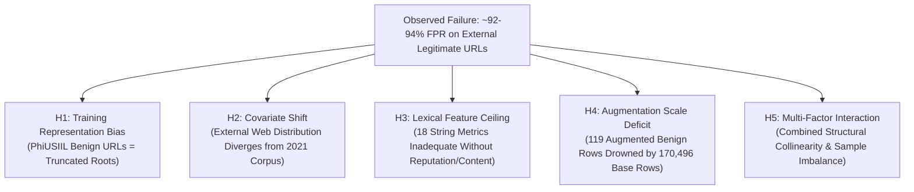
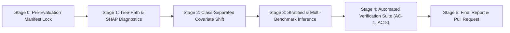

# Phase 7 Milestone 6: Operational Readiness & Generalisation Assessment
## Engineering & Diagnostic Specification

- **Milestone Code:** `Phase 7 — M6`
- **Milestone Name:** Operational Readiness & Generalisation Assessment
- **Target Branch:** `phase-7-m6-operational-readiness-and-diagnostics`
- **Evaluation Status:** Diagnostic & Investigative Protocol (**Zero Retraining / Zero Production Promotion**)
- **Production Baseline Model (E0):** `models/random_forest_model.joblib`  
  - SHA-256: `95f09ddc7bda88bad29cf8329a5ee83f74079da24d4e916427e95524d02f39bb` (Immutable Control)
- **Experimental Candidate Model (E4):** `models/phase7_candidates/rf_augmented_e4.joblib`  
  - SHA-256: `0f872c0fa3d7f6bedfb5ed922355bb121f9c80d9bd2f991ad1cbb46be08c6f1b` (Frozen Candidate)

---

## 1. Executive Summary & Objective

In Phase 7 Milestone 5.1, confirmatory external evaluation against an independently crawled, socket-verified benchmark (`m5_1_qualified_benchmark.csv`, $N=1,300$, 810 unique registered domains) confirmed that Candidate Model E4 achieves high threat recall ($99.23\%$ at $T=0.75$, $+2.15\%$ gain over control E0, $p = 0.0010$). However, both models exhibited catastrophic false positive rates (FPR) on authentic legitimate URLs:
- **Frozen Control E0:** $\text{FPR} = 94.1538\%$ ($612/650$ false alarms at $T=0.75$)
- **Candidate Model E4:** $\text{FPR} = 92.6154\%$ ($602/650$ false alarms at $T=0.75$)

Because an operational deployment ceiling mandates $\text{FPR} \le 0.10\%$, Candidate E4 was determined as **State 3 — FAIL: False Alarm Deficit Exceeds Operational Ceiling**.

### Core Objective of Milestone 6
Milestone 6 is strictly a **diagnostic and operational readiness assessment milestone**, NOT a model-training or model-improvement milestone. Its purpose is to rigorously determine **why** the current phishing detection architecture fails on authentic legitimate URLs, isolating the underlying mechanisms through:
1. Tree-level decision path extraction and split rule attribution across all 100 forest estimators.
2. Class-separated covariate shift analysis (comparing legitimate training data to legitimate external data independently from phishing-to-phishing shifts).
3. Structural and sector-level error decomposition across six frozen strata.
4. Attribution disentanglement isolating representation bias, covariate shift, lexical feature ceilings, and augmentation sample sizes.
5. Multi-benchmark generalisation across all historical and fresh holdout distributions.

> [!IMPORTANT]
> **Governance Invariant:** E0 remains the frozen production baseline control. E4 remains an experimental candidate. Under no circumstances will either model be retrained, fine-tuned, re-weighted, threshold-tuned, modified, or promoted during Milestone 6.

---

## 2. Research Hypotheses & Diagnostic Boundaries

To maintain scientific integrity, observational correlations must not be conflated with proven causal attribution. M6 defines five distinct, competing hypotheses to be evaluated against empirical data:



- **Hypothesis $H_1$ (Training Representation Bias):** Benign URLs in the `PhiUSIIL` training set are structurally unrepresentative of the live web (e.g., $100\%$ lack query parameters; max length $\le 57$), causing tree splits to treat basic URL complexity as indicative of phishing.
- **Hypothesis $H_2$ (Covariate Shift):** Natural temporal and architectural evolution of institutional web routing since 2021 has introduced feature distributions unseen during model development.
- **Hypothesis $H_3$ (Lexical Feature Ceiling):** Purely lexical string properties (character ratios, length, delimiters) are mathematically insufficient to differentiate complex legitimate routes (e.g., RESTful APIs, query filters) from phishing lures without domain reputation, WHOIS age, or content signals.
- **Hypothesis $H_4$ (Augmentation Scale Deficit):** The candidate augmentation in M3 added only 119 benign URLs ($0.07\%$ of the 170,615 training rows), which was mathematically insufficient to shift splitting thresholds across 100 bootstrap estimators.
- **Hypothesis $H_5$ (Interaction Effect):** The failure is driven by joint interactions between training bias and feature collinearity.

---

## 3. Required Specification Structure & Deliverables

### Section M6.1: Root-Cause and Tree-Path Investigation
**Objective:** Dissect the internal voting mechanism of both Random Forest ensembles (E0 and E4) to identify the exact feature thresholds and split sequences responsible for misclassifying legitimate URLs.

1. **Decision Path Extraction Protocol:**
   - For every false-positive URL $x \in \mathcal{D}_{\text{External, Legit}}^{\text{FP}}$ ($n = 612$ for E0, $n = 602$ for E4 at $T=0.75$), extract the full decision path across all 100 decision trees:
     $$\mathcal{P}_t(x) = \left[ (f_1, \theta_1, \text{dir}_1), (f_2, \theta_2, \text{dir}_2), \dots, (f_d, \theta_d, \text{leaf}) \right] \quad \text{for } t \in \{1, \dots, 100\}$$
   - Identify the leaf node class distributions $\left( \frac{n_{\text{phish}}}{n_{\text{total}}}, \frac{n_{\text{legit}}}{n_{\text{total}}} \right)$ where samples land.
2. **Quantitative Metrics:**
   - **Root Split Dominance:** Percentage of trees where the root or depth-1 split is controlled by `IsHTTPS`, `NoOfOtherSpecialCharsInURL`, `URLLength`, or `LetterRatioInURL`.
   - **Critical Threshold Crossing Frequency:** For each feature $f \in \mathcal{F}$, compute the proportion of trees where $x[f] > \theta_{t, i}$ directly forced the traversal into a predominantly phishing subtree.
   - **Ensemble Agreement (Vote Entropy):** Compute the distribution of tree votes $V(x) = \frac{1}{100} \sum_{t=1}^{100} \mathbb{I}(\text{Tree}_t(x) = \text{Phishing})$ to assess whether false positives are borderline ($V \approx 0.51$) or unanimous ($V > 0.90$).
3. **Comparative Analysis (E0 vs E4):**
   - Quantify whether the 119 augmented URLs in E4 altered tree-level decision paths for any subset of estimators, identifying precisely which trees modified their split criteria.

---

### Section M6.2: SHAP Global and Local Attribution
**Objective:** Quantify additive feature contributions to the log-odds prediction for both models using TreeSHAP.

1. **Attribution Formulation:**
   - Compute exact Shapley values via TreeSHAP:
     $$f(x) = \phi_0 + \sum_{i=1}^{18} \phi_i(x)$$
     where $\phi_i(x)$ is the marginal contribution of feature $i$ to the model output probability $P(\text{phishing} \mid x)$.
2. **Deliverables:**
   - **Global Summary Beeswarm Plot:** Global feature impact on the external benchmark, highlighting directionality (e.g., how higher values of `URLLength` or `NoOfOtherSpecialCharsInURL` drive positive log-odds).
   - **Class-Separated SHAP Distributions:** Compare mean absolute SHAP values $|\phi_i|$ between:
     - True Positives (genuine phishing caught)
     - False Positives (legitimate URLs false-alarmed)
     - True Negatives (legitimate URLs correctly passed)
   - **Local Force Plots for Archetypal Errors:** Individual breakdown of 5 representative institutional URLs from diverse sectors (`.gov`, `.edu`, `.be`, e-commerce).
   - **SHAP Interaction Values:** Compute second-order interaction matrices $\phi_{i, j}(x)$ to evaluate non-linear compounding effects (e.g., `URLLength` $\times$ `NoOfOtherSpecialCharsInURL`).

---

### Section M6.3: Class-Separated Covariate Shift & Feature Drift
**Objective:** Measure distribution shift between training and external operational environments without confounding class-composition differences with feature drift.

> [!IMPORTANT]
> **Mandatory Methodological Rule:**
> Covariate shift MUST be evaluated separately for legitimate and phishing partitions:
> 1. $\mathcal{D}_{\text{Train, Legit}}$ vs $\mathcal{D}_{\text{External, Legit}}$ ($n = 134,850$ vs $n = 650$)
> 2. $\mathcal{D}_{\text{Train, Phish}}$ vs $\mathcal{D}_{\text{External, Phish}}$ ($n = 100,945$ vs $n = 650$)
> A pooled comparison ($X_{\text{train}}$ vs $X_{\text{external}}$) is strictly prohibited as it would conflate class prevalence with genuine feature drift.

1. **Statistical Drift Quantifiers:**
   - **Population Stability Index (PSI):**
     $$\text{PSI}_f = \sum_{b=1}^{B} \left( P_b - Q_b \right) \ln\left(\frac{P_b}{Q_b}\right)$$
     where $P_b$ is the proportion of samples in bin $b$ for the external benchmark, and $Q_b$ is the proportion in the training baseline.
     - Thresholds: $\text{PSI} < 0.10$ (No shift), $0.10 \le \text{PSI} < 0.25$ (Moderate shift), $\text{PSI} \ge 0.25$ (Severe shift).
   - **Two-Sample Kolmogorov-Smirnov (KS) Test:** Compute supremum difference $D_{KS} = \sup_v |F_{\text{train}}(v) - F_{\text{ext}}(v)|$ and asymptotic $p$-value.
   - **Wasserstein Distance (Earth Mover's Distance):** $\mathcal{W}_1(P, Q) = \int_{-\infty}^{\infty} |F_P(v) - F_Q(v)| dv$.
2. **Tabular Deliverable:**
   A complete 18-feature drift scorecard reporting $\text{PSI}$, $D_{KS}$, $p_{KS}$, mean $\mu$, standard deviation $\sigma$, and 95th percentiles across both partitions.

---

### Section M6.4: Structural and Sector-Level Error Analysis
**Objective:** Decompose false positive errors across frozen architectural URL categories and institutional sectors with explicit statistical denominators.

1. **Frozen Structural Strata Definitions (Mutually Exclusive):**
   Assignment follows deterministic priority rules (evaluated in order):
   ```python
   def assign_structural_stratum(parsed_url) -> str:
       if has_special_syntax(parsed_url):      # IP, @, non-standard port, %xx
           return "special_syntax_variants"
       if parsed_url.query and parsed_url.path in ("", "/"):
           return "root_with_query"
       if parsed_url.query and len(parsed_url.path.strip("/").split("/")) >= 1:
           return "path_and_query"
       if not parsed_url.path or parsed_url.path == "/":
           return "homepage_root"
       if len(parsed_url.path.strip("/").split("/")) == 1:
           return "single_level_path_no_query"
       return "multi_level_path_no_query"
   ```
2. **Institutional Sector Decomposition:**
   - E-Commerce & Retail ($n_l = 130$)
   - Higher Education & Research ($n_l = 130$)
   - Banking & Financial Regulators ($n_l = 130$)
   - National Government & Ministries ($n_l = 130$)
   - General Institutional & Open Infrastructure ($n_l = 130$)
3. **Statistical Reporting Standard:**
   - Every stratum and sector must report:
     - Sample sizes: $N_{\text{total}}$, $n_{\text{phish}}$, $n_{\text{legit}}$.
     - Point estimate FPR and Phishing Recall.
     - Exact Clopper-Pearson 95% binomial confidence intervals for FPR:
       $$\text{CI}_{0.95} = \left[ B\left(\frac{\alpha}{2}; x, n - x + 1\right), B\left(1 - \frac{\alpha}{2}; x + 1, n - x\right) \right]$$
     - Sample size caveat label: `Small (n < 30)` or `Adequate (n >= 30)`.

---

### Section M6.5: Attribution Disentanglement
**Objective:** Empirically differentiate between representation bias, lexical feature bounds, covariate shift, and augmentation scale without asserting unverified causal claims.

1. **Factor Decomposition Framework:**
   - **Factor A (Representation Bias):** Measure model accuracy on synthetically generated root-only vs authentic path-bearing versions of the same domains.
   - **Factor B (Lexical Separability Ceiling):** Train a linear probe (logistic regression with $L_1$ penalty) on the external benchmark to determine whether the 18 lexical features can linearly separate the external legitimate and phishing classes.
   - **Factor C (Covariate Shift):** Evaluate whether retraining on domain-diverse benign data resolves the error or if lexical features remain fundamentally collinear with phishing.
   - **Factor D (Augmentation Sample Size Dilution):** Empirically model ensemble tree penetration as a function of augmentation sample size ($k=119$ vs $k=1,000$ vs $k=10,000$).
2. **Scientific Reporting Language:**
   - Avoid definitive statements of single-cause attribution. Frame findings in terms of observed variance explained, bounds of lexical separability, and distribution divergence.

---

### Section M6.6: Multi-Benchmark Cross-Generalisation
**Objective:** Compare E0 and E4 across all four historical and fresh evaluation benchmarks to evaluate model stability across independent evaluation contexts.

1. **Cryptographically Locked Holdouts:**
   | Benchmark Dataset | Artifact Path | Expected SHA-256 | Sample Count | Domain Count | Provenance |
   |:---|:---|:---|:---:|:---:|:---|
   | **Phase 7 Internal Test Split** | `experiments/phase7/datasets/splits/internal_test.csv` | `ce004e9d8e65ea8c09175d904d4a5fee0442acc4b127af6a98f58ae0aed0e2cf` | 34,092 | 25,978 | Domain-disjoint holdout from PhiUSIIL |
   | **Historical External Benchmark (Phase 4/6)** | `data/external/external_validation_benchmark.csv` | `88525183abd402e385c6329c49b8d551db86b22bcf03d8429de37d477c8312c3` | 1,047 | 892 | Historical external benchmark |
   | **Phase 7 M5.1 Qualified Benchmark** | `experiments/phase7/external/datasets/m5_1_qualified_benchmark.csv` | `f6cdbf797b683d6c82d7b5c72c6ddf35aba7cbb448edafc2d68e67e26695fc88` | 1,300 | 810 | Socket-verified live crawl (0 historical overlap) |
2. **Pre-Flight Invariant Checks:**
   - Verify SHA-256 digests against pre-evaluation manifest before running comparisons.
   - Audit registered-domain overlap across all 4 datasets to report exact historical leakage metrics.
3. **Harmonized Evaluation Metrics:**
   - Thresholds: $T = 0.50$ (Primary) and $T = 0.75$ (Secondary).
   - Metrics: Phishing Recall, Legitimate FPR, Macro F1, ROC-AUC, PR-AUC, Brier Score.
   - Paired McNemar $\chi^2$ and $p$-value for discordant pairs between E0 and E4.

---

### Section M6.7: Bayesian Operational Reliability
**Objective:** Translate raw TPR and FPR into actionable real-world security metrics across varying threat environments.

1. **Prevalence Priors $\pi$:**
   - Gateway / Proxy Inspection: $\pi = 0.0001$ ($0.01\%$, 1 phishing URL per 10,000 URLs).
   - Targeted Email Filter: $\pi = 0.001$ ($0.10\%$, 1 phishing URL per 1,000 URLs).
   - High-Risk Influx / Incident Response: $\pi = 0.01$ ($1.00\%$, 1 phishing URL per 100 URLs).
2. **Formulations:**
   $$\text{PPV}(\pi) = \frac{\pi \cdot \text{Recall}}{\pi \cdot \text{Recall} + (1 - \pi) \cdot \text{FPR}}$$
   $$\text{False Alarm Multiplier (FAM)} = \frac{(1 - \pi) \cdot \text{FPR}}{\pi \cdot \text{Recall}} = \frac{1}{\text{PPV}} - 1$$
3. **Reporting Standards:**
   - Provide tabular and graphical PPV curves.
   - State the False Alarm Multiplier explicitly: how many benign URLs are falsely blocked for every genuine phishing URL detected.

---

### Section M6.8: Production Governance & Evidence Integrity
**Objective:** Maintain cryptographic reproducibility, model immutability, and compliance with project invariants.

1. **Model Governance Invariants:**
   - Control E0 (`models/random_forest_model.joblib`) must match `95f09ddc...2f39bb`.
   - Candidate E4 (`models/phase7_candidates/rf_augmented_e4.joblib`) must match `0f872c0f...c6f1b`.
   - Zero model files may be created or overwritten in `models/`.
2. **Manifest Architecture:**
   - Create `experiments/phase7/reports/m6_operational_readiness_manifest.json` before unsealing diagnostics.
   - Create `experiments/phase7/reports/m6_diagnostic_scorecard.json` upon execution.
   - Create `experiments/phase7/reports/m6_operational_readiness_report.md`.
3. **Automated Verification:**
   - All diagnostic outputs, decision-path extractors, and drift calculators must be tested in `experiments/phase7/tests/test_m6_operational_readiness.py`.

---

## 4. Formal Acceptance Criteria (AC-1 through AC-8)

| Criteria | Title | Verification Target |
|:---|:---|:---|
| **AC-1** | **Tree Decision Path Extraction** | Decision paths extracted across 100 trees for all false-positive URLs; leaf-node purity and root split features quantified. |
| **AC-2** | **SHAP Global & Local Attribution** | Global beeswarm, class-separated $|\phi_i|$ comparisons, and 5 local force plots generated and saved as artifacts. |
| **AC-3** | **Class-Separated Covariate Shift** | PSI and KS statistics computed strictly within legitimate ($\mathcal{D}_{\text{train, legit}}$ vs $\mathcal{D}_{\text{ext, legit}}$) and phishing ($\mathcal{D}_{\text{train, phish}}$ vs $\mathcal{D}_{\text{ext, phish}}$) partitions separately across all 18 features. |
| **AC-4** | **Structural Strata & Sector Error Matrix** | FPR and Recall evaluated across the 6 frozen strata and 5 sectors with explicit denominators and Clopper-Pearson 95% CIs. |
| **AC-5** | **Attribution Disentanglement** | Empirical tests evaluating representation bias, linear probe lexical ceiling, and augmentation scale dilution completed and reported. |
| **AC-6** | **Multi-Benchmark Generalisation** | Comparative performance of E0 vs E4 evaluated across Internal Test ($N=34,092$), Historical External ($N=1,047$), and M5.1 Qualified ($N=1,300$) with verified SHA-256 hashes. |
| **AC-7** | **Bayesian PPV & False Alarm Multipliers** | PPV and False Alarm Multipliers calculated and tabulated across $\pi \in \{10^{-4}, 10^{-3}, 10^{-2}\}$ at $T=0.50$ and $T=0.75$. |
| **AC-8** | **Production Governance & Model Immutability** | Cryptographic assertion that E0 and E4 model files are byte-for-byte unchanged; zero model promotion or retraining permitted. |

---

## 5. Execution Roadmap & Staged Implementation Plan

Upon formal user approval of this specification, implementation will proceed in strictly staged phases:



1. **Stage 0 (Pre-Flight Lock):** Generate `m6_operational_readiness_manifest.json` locking all dataset and model hashes.
2. **Stage 1 (Ensemble Dissection):** Author `extract_tree_decision_paths.py` and `compute_shap_attributions.py`.
3. **Stage 2 (Distribution Drift):** Author `compute_covariate_shift.py` enforcing class-separated PSI and KS tests.
4. **Stage 3 (Multi-Holdout Inference):** Author `evaluate_multi_benchmark_generalisation.py` covering all 4 benchmarks.
5. **Stage 4 (Verification Suite):** Implement `experiments/phase7/tests/test_m6_operational_readiness.py` validating AC-1 through AC-8.
6. **Stage 5 (Report Compilation):** Emit `m6_diagnostic_scorecard.json` and `m6_operational_readiness_report.md`, and open PR for review.
