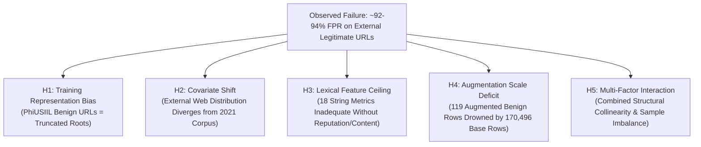
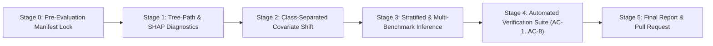

# Phase 7 Milestone 6: Operational Readiness & Generalisation Assessment
## Engineering & Diagnostic Specification (Revision 2 — Post-Review)

- **Milestone Code:** `Phase 7 — M6`
- **Milestone Name:** Operational Readiness & Generalisation Assessment
- **Target Branch:** `phase-7-m6-operational-readiness-and-diagnostics`
- **Evaluation Status:** Diagnostic & Investigative Protocol (**Zero Retraining / Zero Production Promotion**)
- **Production Baseline Model (E0):** `models/random_forest_model.joblib`  
  - SHA-256: `95f09ddc7bda88bad29cf8329a5ee83f74079da24d4e916427e95524d02f39bb` (Immutable Control)
- **Experimental Candidate Model (E4):** `models/phase7_candidates/rf_augmented_e4.joblib`  
  - SHA-256: `0f872c0fa3d7f6bedfb5ed922355bb121f9c80d9bd2f991ad1cbb46be08c6f1b` (Frozen Candidate)

---

## 1. Executive Summary & Objective

In Phase 7 Milestone 5.1, confirmatory external evaluation against an independently crawled, socket-verified benchmark (`m5_1_qualified_benchmark.csv`, $N=1,300$, 810 unique registered domains) confirmed that Candidate Model E4 achieves high threat recall ($99.23\%$ at $T=0.75$, $+2.15\%$ gain over control E0, $p = 0.0010$). However, both models exhibited catastrophic false positive rates (FPR) on authentic legitimate URLs:
- **Frozen Control E0:** $\text{FPR} = 94.1538\%$ ($612/650$ false alarms at $T=0.75$)
- **Candidate Model E4:** $\text{FPR} = 92.6154\%$ ($602/650$ false alarms at $T=0.75$)

Because the operational deployment ceiling mandates $\text{FPR} \le 0.10\%$, Candidate E4 was determined as **State 3 — FAIL: False Alarm Deficit Exceeds Operational Ceiling**.

### Core Objective of Milestone 6
Milestone 6 is strictly a **diagnostic and operational readiness assessment milestone**, NOT a model-training or model-improvement milestone. Its sole purpose is to establish, with reproducible observational evidence, **why** the current phishing detection architecture fails on authentic legitimate URLs.

> [!IMPORTANT]
> **Strict Governance Invariants:**
> 1. **Zero Retraining:** Under no circumstances will any model be retrained, fine-tuned, re-weighted, threshold-tuned, modified, or promoted.
> 2. **Model Immutability:** E0 remains the frozen production baseline control (`95f09ddc...`). E4 remains an experimental candidate (`0f872c0f...`). Both model artifacts are loaded read-only and cryptographically verified before and after every diagnostic run.
> 3. **Observational Discipline:** M6 evaluates observational associations, distributions, and structural properties. Correlational observations must not be reported as proven causal conclusions.
> 4. **Diagnostic Probe Classification:** Any secondary statistical probe (such as domain-grouped linear probes) is strictly classified as a diagnostic-only statistical fit, not a candidate model or retraining.

---

## 2. Research Hypotheses & Diagnostic Boundaries

To avoid premature causal conclusions, M6 evaluates five distinct, non-exclusive hypotheses using observational data:



- **Hypothesis $H_1$ (Training Representation Bias):** Benign URLs in the `PhiUSIIL` training set are structurally unrepresentative of the live web (e.g., in the training partition, $100\%$ lack query parameters and max length is $\le 57$), causing tree splits to associate URL complexity with phishing.
- **Hypothesis $H_2$ (Covariate Shift):** Natural temporal and architectural evolution of institutional web routing since 2021 has introduced feature distributions unseen during model development.
- **Hypothesis $H_3$ (Lexical Feature Ceiling):** Purely lexical string properties (character ratios, length, delimiters) are mathematically insufficient to differentiate complex legitimate routes (e.g., query filters, deep REST routes) from phishing lures without domain reputation, WHOIS age, or content signals.
- **Hypothesis $H_4$ (Augmentation Scale Deficit):** The candidate augmentation in M3 added only 119 benign URLs ($0.07\%$ of the 170,615 training rows), which was numerically diluted across the 100 bootstrap estimators.
- **Hypothesis $H_5$ (Interaction Effect):** The failure is driven by joint interactions between training representation bias and feature collinearity.

---

## 3. Required Specification Structure & Deliverables

### Section M6.1: Root-Cause and Tree-Path Investigation
**Objective:** Dissect the internal voting mechanism of both Random Forest ensembles (E0 and E4) to identify the exact feature thresholds and split sequences responsible for misclassifying legitimate URLs.

1. **Estimator Correspondence Methodology:**
   - Because Random Forest decision trees are trained via bootstrap subsampling and random feature selection, individual estimators between independently trained forests (E0 vs E4) **do not have a 1:1 index correspondence** (i.e. Tree $k$ in E0 does not correspond to Tree $k$ in E4).
   - Therefore, tree comparisons between E0 and E4 will be reported as **ensemble-wide structural distributions** and **aggregate node statistics**, not as individual tree-to-tree differences.
2. **Decision Path Extraction Protocol:**
   - For every false-positive URL $x \in \mathcal{D}_{\text{External, Legit}}^{\text{FP}}$ ($n = 612$ for E0, $n = 602$ for E4 at $T=0.75$), extract the full decision path across all 100 decision trees:
     $$\mathcal{P}_t(x) = \left[ (f_1, \theta_1, \text{dir}_1), (f_2, \theta_2, \text{dir}_2), \dots, (f_d, \theta_d, \text{leaf}) \right] \quad \text{for } t \in \{1, \dots, 100\}$$
   - Record the leaf node class distributions $\left( \frac{n_{\text{phish}}}{n_{\text{total}}}, \frac{n_{\text{legit}}}{n_{\text{total}}} \right)$ where samples land.
3. **Quantitative Metrics:**
   - **Root & Depth-1 Split Feature Dominance:** Percentage of trees where root or depth-1 splits use `IsHTTPS`, `NoOfOtherSpecialCharsInURL`, `URLLength`, or `LetterRatioInURL`.
   - **Critical Threshold Crossing Frequency:** For each feature $f \in \mathcal{F}$, compute the proportion of trees where $x[f] > \theta_{t, i}$ directly routes traversal into a predominantly phishing subtree.
   - **Ensemble Agreement (Vote Entropy):** Compute the distribution of tree votes $V(x) = \frac{1}{100} \sum_{t=1}^{100} \mathbb{I}(\text{Tree}_t(x) = \text{Phishing})$ to assess whether false positives are borderline ($V \approx 0.51$) or unanimous ($V > 0.90$).
   - **Ensemble Tree Purity Distribution:** Compare tree leaf impurity distributions (Gini index at termination) between E0 and E4 across all 100 estimators.

---

### Section M6.2: SHAP Global and Local Attribution
**Objective:** Quantify additive feature contributions to model predictions using TreeSHAP with strict probability-space additivity verification.

1. **Output Space & Formulation:**
   - **Single Output Space:** All SHAP values are computed strictly in **probability space for the Phishing class ($P(\text{phishing}) \in [0, 1]$)**.
   - **Class Index Lock:** Class index 0 is Phishing (`clf.classes_ == [0, 1]`, `phishing_index == 0`).
   - **Background Dataset Lock:** Default `feature_perturbation="tree_path_dependent"` is locked, which leverages the empirical node sample distributions stored in the trained decision tree leaves.
   - **Output Shape Lock:** Output shape is `(N, 18, 2)` for multi-class explainer output, with `shap_values[:, :, 0]` locking the Phishing class attributions.
   - **Additive Property:**
     $$\hat{P}(\text{phishing} \mid x) = \phi_0 + \sum_{i=1}^{18} \phi_i(x)$$
     where $\phi_0 = \mathbb{E}[P(\text{phishing})]$ is the expected tree leaf probability of phishing across the background dataset (`explainer.expected_value[0]`), and $\phi_i(x)$ is the marginal additive probability contribution of feature $i$.
   - **Probability-Space Additivity Verification:**
     For all representative evaluation records, the implementation MUST verify that:
     $$\left| \left( \phi_0 + \sum_{i=1}^{18} \phi_i(x) \right) - \text{predict\_proba}(x)[0] \right| \le 10^{-5}$$
     Any violation of this numerical tolerance MUST raise an explicit `AssertionError` and abort execution immediately.
   - **Interpretation:** $\phi_i(x) > 0$ increases the predicted phishing probability, while $\phi_i(x) < 0$ decreases it.
2. **Deliverables:**
   - **Global Summary Beeswarm Plot:** Global feature impact on the external benchmark, showing directionality and magnitude.
   - **Class-Separated SHAP Distributions:** Compare mean absolute SHAP values $|\phi_i|$ between:
     - True Positives (genuine phishing detected)
     - False Positives (legitimate URLs false-alarmed)
     - True Negatives (legitimate URLs correctly passed)
   - **Local Force Plots for Archetypal Errors:** Individual breakdown of 5 representative institutional URLs from diverse sectors (`.gov`, `.edu`, `.be`, e-commerce).
   - **SHAP Interaction Values:** Compute second-order interaction matrices $\phi_{i, j}(x)$ to evaluate non-linear compounding effects (e.g., `URLLength` $\times$ `NoOfOtherSpecialCharsInURL`).

---

### Section M6.3: Class-Separated Covariate Shift & Feature Drift
**Objective:** Measure distribution shift between training and external operational environments without confounding class-composition differences with feature drift.

> [!IMPORTANT]
> **Mandatory Methodological Rule:**
> Covariate shift MUST be evaluated separately for legitimate and phishing partitions:
> 1. $\mathcal{D}_{\text{Train, Legit}}$ vs $\mathcal{D}_{\text{External, Legit}}$ ($n = 94,523$ vs $n = 650$)
> 2. $\mathcal{D}_{\text{Train, Phish}}$ vs $\mathcal{D}_{\text{External, Phish}}$ ($n = 76,092$ vs $n = 650$)
> A pooled comparison ($X_{\text{train}}$ vs $X_{\text{external}}$) is strictly prohibited as it would conflate class prevalence with genuine feature drift.

1. **Statistical Drift Quantifiers:**
   - **Population Stability Index (PSI):**
     $$\text{PSI}_f = \sum_{b=1}^{B} \left( \tilde{p}_b - \tilde{q}_b \right) \ln\left(\frac{\tilde{p}_b}{\tilde{q}_b}\right)$$
     - **Reference Population ($Q$):** Training split ($\mathcal{D}_{\text{train}}$).
     - **Evaluation Population ($P$):** External benchmark ($\mathcal{D}_{\text{external}}$).
     - **Bin Edges:** 10 quantile bins derived from the reference population. Discrete/binary features (`IsDomainIP`, `HasObfuscation`, `IsHTTPS`) use exact categorical bins $[0, 1]$.
     - **Zero-Count Smoothing:** Epsilon $\epsilon = \frac{1}{2 \cdot N_{\text{ext}}}$ added to zero-count bins in reference and evaluation populations:
       $$\tilde{n}_{P, b} = n_{P, b} + \epsilon, \quad \tilde{p}_b = \frac{\tilde{n}_{P, b}}{\sum_{k=1}^B \tilde{n}_{P, k}}$$
       Proportions are verified to strictly satisfy $\sum_{b=1}^B \tilde{p}_b = 1.0$ and $\sum_{b=1}^B \tilde{q}_b = 1.0$.
     - **Constant Feature Handling:** If a feature has zero variance in the reference population, report $\text{PSI} = 0.0$ if identically constant in the evaluation set, or flag as degenerate shift ($\infty$).
     - **Thresholds:** $\text{PSI} < 0.10$ (No significant shift), $0.10 \le \text{PSI} < 0.25$ (Moderate shift), $\text{PSI} \ge 0.25$ (Severe shift).
   - **Two-Sample Kolmogorov-Smirnov (KS) Test:**
     - Report the **effect size $D_{KS} = \sup_v |F_{\text{train}}(v) - F_{\text{ext}}(v)|$** alongside the asymptotic $p$-value. Because $N_{\text{train}} > 75,000$, virtually all $p$-values reach significance ($p < 10^{-15}$); operational drift must be judged by effect size:
       - $D_{KS} < 0.10$: Negligible divergence.
       - $0.10 \le D_{KS} < 0.25$: Moderate divergence.
       - $D_{KS} \ge 0.25$: Substantial / severe divergence.
   - **Wasserstein Distance:** $\mathcal{W}_1(P, Q) = \int_{-\infty}^{\infty} |F_P(v) - F_Q(v)| dv$.
2. **Tabular Deliverable:** Complete 18-feature drift scorecard reporting $\text{PSI}$, $D_{KS}$, $p_{KS}$, mean $\mu$, standard deviation $\sigma$, and 95th percentiles across both partitions.

---

### Section M6.4: Structural and Sector-Level Error Analysis
**Objective:** Decompose false positive errors across frozen architectural URL categories and institutional sectors with deterministic parsing, anomaly handling, and exact statistical denominators.

1. **Frozen Structural Strata Definitions (Mutually Exclusive):**
   Parsing follows unambiguous priority logic with deterministic edge-case handling:
   ```python
   def extract_path_segments(path: str) -> List[str]:
       """Normalize and split path into non-empty segments, collapsing repeated slashes."""
       clean = re.sub(r"/+", "/", path.strip())
       return [s for s in clean.split("/") if s]

   def classify_structural_stratum(url: str) -> Tuple[str, Optional[Dict[str, str]]]:
       """
       Priority 1: Special syntax variants
       - IP literal (IPv4 or IPv6 in netloc/host)
       - Userinfo / Credentials (@ in netloc)
       - Non-standard port (present and not in (80, 443))
       - Malformed / non-numeric port or unparseable host
       - Hex / percent-encoding (% in URL, including valid and malformed)
       
       Priority 2: root_with_query
       - 0 path segments and non-empty query string
       
       Priority 3: path_and_query
       - >= 1 path segments and non-empty query string
       
       Priority 4: homepage_root
       - 0 path segments and no query
       
       Priority 5: single_level_path_no_query
       - Exactly 1 path segment and no query
       
       Priority 6: multi_level_path_no_query
       - >= 2 path segments and no query
       """
   ```

2. **Deterministic Edge-Case & Parsing Failure Handling:**
   - **Repeated Slashes:** Normalized via `re.sub(r"/+", "/", path)`.
   - **Trailing Slashes:** Stripped before segment extraction so `https://example.com/` is classified as `homepage_root` and `https://example.com/about/` is classified as `single_level_path_no_query`.
   - **Bare Query Delimiters:** A trailing bare query delimiter (e.g. `https://example.com/?`) yields an empty query string (`""`) and is classified as `homepage_root` (`has_query = False`). Query parameters with empty values (e.g. `https://example.com/?key=`) yield non-empty query strings and are classified as `root_with_query` (`has_query = True`).
   - **Invalid Ports & Malformed Hosts:** If `urlsplit` raises an exception or accessing `parsed.port`/`parsed.hostname` raises `ValueError` (e.g. `example.com:invalid` or unbracketed IPv6), catch the exception, log it in `parsing_failures` registry, and deterministically assign the URL to `special_syntax_variants`.
   - **Malformed Percent-Encoding:** URLs with incomplete or malformed percent-encoding (`%ZZ`, bare `%`) route to `special_syntax_variants`.
   - **Parsing Failure Audit:** All parsing exceptions are explicitly logged and aggregated in the audit report (`URL`, `exception_type`, `error_message`, `assigned_stratum`).

3. **Institutional Sector Decomposition:**
   - **Scope:** The five institutional sectors apply specifically to the 650 legitimate URLs in the M5.1 qualified benchmark ($n_{\text{legit}} = 130$ per sector):
     1. E-Commerce & Retail ($n_{\text{legit}} = 130$)
     2. Higher Education & Research ($n_{\text{legit}} = 130$)
     3. Banking & Financial Regulators ($n_{\text{legit}} = 130$)
     4. National Government & Ministries ($n_{\text{legit}} = 130$)
     5. General Institutional & Open Infrastructure ($n_{\text{legit}} = 130$)
   - **Sector Provenance:** Sector labels were assigned during external catalog curation based on official institutional registries, independently of model predictions.
   - **Phishing Denominators:** The 650 phishing URLs in M5.1 were sourced from PhishTank community consensus and reside in the separate `phishing_threat_feed` category ($n_{\text{phish}} = 650$). For the 5 institutional sectors, $n_{\text{phish}} = 0$; therefore, **Phishing Threat Recall is mathematically undefined for individual institutional sectors** (reported as `Undefined (n_p = 0)`), NOT zero.

4. **Statistical Reporting Standard:**
   - Denominator strictly defined: $\text{FPR} = \frac{\text{FP}}{n_{\text{legit}}}$ where $n_{\text{legit}}$ is the number of legitimate observations in that stratum/sector.
   - Exact Clopper-Pearson 95% binomial confidence intervals with explicit boundary handling:
     - For $x = 0$: Lower CI = $0.0$, Upper CI = $1 - (\alpha / 2)^{1 / n}$ ($1 - 0.025^{1/n}$ for $\alpha = 0.05$).
     - For $x = n$: Lower CI = $(\alpha / 2)^{1 / n}$ ($0.025^{1/n}$ for $\alpha = 0.05$), Upper CI = $1.0$.
     - For $0 < x < n$: Standard Beta distribution quantiles $[B(\alpha/2; x, n-x+1), B(1-\alpha/2; x+1, n-x)]$.
   - Explicit sample size caveat: `Small (n_l < 30)` or `Adequate (n_l >= 30)`.

---

### Section M6.5: Attribution Disentanglement (Strictly Observational)
**Objective:** Empirically evaluate the five research hypotheses through observational analysis of existing frozen models and datasets without retraining.

1. **Observational Analyses (Zero Retraining):**
   - **Factor A (Representation Disparity & Bounding-Box Coverage):**
     - Compute univariate min-max bounds and quantiles (P1, P5, P25, P50, P75, P95, P99) for all 18 features on the frozen training split ($N=170,615$).
     - On the external benchmark ($N=1,300$), report:
       * Per-feature out-of-range rates ($\text{OOR}_f$: under min, over max, and total).
       * Record-level union out-of-range rate ($\text{OOR}_{\ge 1}$, proportion of records with at least one feature outside training $[\min, \max]$).
       * Record-level multi-feature out-of-range rates ($\text{OOR}_{\ge 2}$, $\text{OOR}_{\ge 3}$).
       * Histogram of out-of-range feature counts per record.
     - **Multivariate Distinction Caveat:** Explicitly distinguish univariate bounding-box support from joint multivariate distribution coverage. Univariate range checks test only marginal 1D extremes; a sample can fall strictly inside all 18 univariate bounds while residing in an empty or unpopulated region of the joint 18-dimensional feature space. Univariate range compliance is a necessary baseline condition, but does NOT establish joint in-distribution coverage.
   - **Factor B (Lexical Separability Measurement via Domain-Grouped OOF Evaluation):**
     - Fit an observational linear probe (Logistic Regression with $L_1$ penalty) strictly using **5-fold registered-domain-grouped cross-validation** (`StratifiedGroupKFold(n_splits=5, shuffle=True, random_state=42)` grouped by `registered_domain`) on the frozen external benchmark ($N=1,300$, 810 registered domains).
     - Compute out-of-fold (OOF) predictions across the holdout folds so that no registered domain appears in both train and validation folds.
     - Evaluate OOF ROC-AUC, OOF Macro F1, and OOF FPR at $T=0.50$ and $T=0.75$.
     - **Classification & Prohibitions:**
       * Explicitly classify the probe as a **diagnostic-only statistical fit**, NOT an E0/E4 candidate or retraining.
       * Do NOT describe the result as a "mathematical upper bound". Report it as an *empirical out-of-fold diagnostic baseline* for linear separability under domain-disjoint grouping.
   - **Factor C (Class-Conditional Feature Overlap):** Quantify intra-class and inter-class Wasserstein distance and feature correlations between legitimate and phishing URLs within the external benchmark. Determine whether lexical features (such as `URLLength` or `NoOfOtherSpecialCharsInURL`) exhibit structural collinearity with the phishing label in real-world traffic.
   - **Factor D (Augmentation Representation in Frozen E4):** Inspect the exact composition of E4's training data ($170,496$ PhiUSIIL rows vs $119$ augmented benign rows; $0.07\%$ ratio). Quantify the aggregate structural differences between E0 and E4 (distribution of node counts, leaf counts, and threshold shifts) to assess whether 119 rows caused measurable structural changes across the 100 trees.

2. **Scientific Reporting Language:**
   - Findings must be framed as observed empirical associations, bounds of separability, and distribution divergence. Do not claim causal mechanisms from observational comparisons alone.

---

### Section M6.6: Multi-Benchmark Cross-Generalisation
**Objective:** Cross-evaluate frozen models E0 and E4 across all three distinct historical and qualified evaluation benchmarks with full cryptographic provenance.

1. **Exact Holdout Inventory (Three Distinct Benchmarks):**
   | Benchmark Dataset | Artifact Path | Expected SHA-256 | Sample Count | Registered Domains | Provenance & Role |
   |:---|:---|:---|:---:|:---:|:---|
   | **1. Internal Test Split** | `experiments/phase7/datasets/splits/internal_test.csv` | `ce004e9d8e65ea8c09175d904d4a5fee0442acc4b127af6a98f58ae0aed0e2cf` | 34,092 | 25,978 | Domain-disjoint holdout from PhiUSIIL (Internal Baseline) |
   | **2. Historical External Benchmark** | `data/external/external_validation_benchmark.csv` | `88525183abd402e385c6329c49b8d551db86b22bcf03d8429de37d477c8312c3` | 1,047 | 892 | Historical external benchmark used in Phase 4 & Phase 6 (Replication Holdout) |
   | **3. M5.1 Qualified External Benchmark** | `experiments/phase7/external/datasets/m5_1_qualified_benchmark.csv` | `f6cdbf797b683d6c82d7b5c72c6ddf35aba7cbb448edafc2d68e67e26695fc88` | 1,300 | 810 | Socket-verified authentic crawl with 100% verified TLS (Independent Operational Holdout) |

   > [!NOTE]
   > **Holdout Resolution Note:** The earlier informal reference to a "1,200-sample Phase 6 benchmark" was legacy planning nomenclature from Phase 4/5. The actual committed historical external artifact is the 1,047-sample `data/external/external_validation_benchmark.csv`. The evaluation inventory is strictly frozen at these three distinct datasets.

2. **Pre-Flight Invariant Checks:**
   - Verify SHA-256 digests against pre-evaluation manifest before running comparisons.
   - Audit registered-domain overlap across all 3 datasets to document historical leakage and independence.
3. **Paired Statistical Comparison Standards:**
   - Thresholds: $T = 0.50$ (Primary) and $T = 0.75$ (Secondary).
   - Metrics: Phishing Recall, Legitimate FPR, Macro F1, ROC-AUC, PR-AUC, Brier Score.
   - **Paired McNemar Tests:** Computed with Edward's continuity correction on discordant pairs:
     $$\chi^2 = \frac{(|n_{01} - n_{10}| - 1)^2}{n_{01} + n_{10}}$$
     where $n_{01}$ represents samples where E0 is correct and E4 is incorrect, and $n_{10}$ represents samples where E0 is incorrect and E4 is correct. McNemar tests evaluate discordant pairs between models, not general metric uncertainty.

---

### Section M6.7: Bayesian Operational Reliability
**Objective:** Translate raw TPR and FPR into actionable real-world security metrics across varying operational threat priors.

1. **Prevalence Priors $\pi$:**
   - Gateway / Proxy Inspection: $\pi = 0.0001$ ($0.01\%$, 1 phishing URL per 10,000 URLs).
   - Targeted Email Filter: $\pi = 0.001$ ($0.10\%$, 1 phishing URL per 1,000 URLs).
   - High-Risk Influx / Incident Response: $\pi = 0.01$ ($1.00\%$, 1 phishing URL per 100 URLs).
2. **Formulations:**
   $$\text{PPV}(\pi) = \frac{\pi \cdot \text{Recall}}{\pi \cdot \text{Recall} + (1 - \pi) \cdot \text{FPR}}$$
   $$\text{False Alarm Multiplier (FAM)} = \frac{(1 - \pi) \cdot \text{FPR}}{\pi \cdot \text{Recall}} = \frac{1}{\text{PPV}} - 1$$
3. **Reporting Standard:**
   - Tabulate PPV and False Alarm Multipliers across both operating thresholds ($T = 0.50, T = 0.75$) for all three benchmarks.
   - State the False Alarm Multiplier explicitly: how many benign URLs are falsely blocked for every genuine phishing URL detected.

---

### Section M6.8: Production Governance & Evidence Integrity
**Objective:** Maintain cryptographic reproducibility, model immutability, and compliance with project invariants.

1. **Model Governance Invariants:**
   - Control E0 (`models/random_forest_model.joblib`) must match `95f09ddc...2f39bb`.
   - Candidate E4 (`models/phase7_candidates/rf_augmented_e4.joblib`) must match `0f872c0f...c6f1b`.
   - Zero model files may be created or overwritten in `models/`. Models must be loaded read-only and verified before and after execution.
2. **Manifest Architecture & Cryptographic Locks:**
   - Pre-evaluation lock: `experiments/phase7/reports/m6_operational_readiness_manifest.json` (Stage 0).
   - Locks exact training partition (`experiments/phase7/datasets/splits/train.csv`, SHA-256 `9297458d...`, 170,615 rows, 94,523 legitimate, 76,092 phishing, 121,217 unique domains).
   - Locks ordered 18-feature schema and code reference (`src/features.py`, SHA-256 `f581fd8e...`).
   - Locks label mapping (`0: "Phishing", 1: "Legitimate"`), decision target index 0 (`Phishing`).
   - Locks preprocessing configuration and data types.
   - Locks runtime environment metadata: Python 3.14.7, scikit-learn 1.9.0, joblib 1.5.3, numpy 2.5.2, pandas 3.0.5, scipy 1.18.0, shap 0.52.0.
   - Locks TreeSHAP configuration: class index 0, tree-path-dependent perturbation, numerical tolerance $\le 10^{-5}$.
   - Diagnostic scorecard: `experiments/phase7/reports/m6_diagnostic_scorecard.json`.
   - Comprehensive audit report: `experiments/phase7/reports/m6_operational_readiness_report.md`.
3. **Automated Verification:**
   - All diagnostic outputs, decision-path extractors, drift calculators, and parsing rules must be tested in `experiments/phase7/tests/test_m6_operational_readiness.py`.

---

## 4. Formal Acceptance Criteria (AC-1 through AC-8)

| Criteria | Title | Verification Target |
|:---|:---|:---|
| **AC-1** | **Stage 0 Manifest & Cryptographic Locks** | Stage 0 manifest locks exact models (E0, E4), three benchmarks, training partition (170,615 rows), ordered 18-feature schema, Python 3.14.7, and 6 core dependency versions. |
| **AC-2** | **SHAP Additivity & Probability Space** | TreeSHAP computed strictly in Phishing probability space ($P(\text{phishing}) \in [0, 1]$); verified against `predict_proba[:, 0]` to $\le 10^{-5}$ precision; explicit fail-fast assertion on any violation. |
| **AC-3** | **Class-Separated Covariate Shift** | PSI and KS statistics ($D_{KS}$ effect size and $p$-value) computed strictly within legitimate ($\mathcal{D}_{\text{train, legit}}$ vs $\mathcal{D}_{\text{ext, legit}}$) and phishing ($\mathcal{D}_{\text{train, phish}}$ vs $\mathcal{D}_{\text{ext, phish}}$) partitions independently across all 18 features using 10 quantile bins and epsilon zero-smoothing ($\epsilon = 1 / (2 \cdot N_{\text{ext}})$). |
| **AC-4** | **Structural Strata & Sector Error Matrix** | Error rates evaluated across the 6 frozen strata and 5 sectors ($n_{\text{legit}} = 130$ each) with deterministic handling for edge cases (repeated slashes, trailing slashes, bare queries, malformed ports/hosts) and explicit Clopper-Pearson boundary handling ($x=0, x=n$). |
| **AC-5** | **Attribution Disentanglement** | Strictly observational analyses completed: training bounding box analysis reporting per-feature, union ($\ge 1$), and multi-range ($\ge 2$) OOR rates with univariate vs multivariate coverage distinction; domain-grouped 5-fold CV out-of-fold linear probe classified as diagnostic fit (not an upper bound); class-conditional Wasserstein distances; and E0 vs E4 structural ensemble metrics without retraining. |
| **AC-6** | **Multi-Benchmark Generalisation** | Comparative metrics and paired McNemar tests computed across exactly three holdouts: Internal Test ($N=34,092$), Historical External ($N=1,047$), and M5.1 Qualified ($N=1,300$) with verified SHA-256 hashes. |
| **AC-7** | **Bayesian PPV & False Alarm Multipliers** | PPV and False Alarm Multipliers calculated and tabulated across $\pi \in \{10^{-4}, 10^{-3}, 10^{-2}\}$ at $T=0.50$ and $T=0.75$. |
| **AC-8** | **Production Governance & Model Immutability** | Cryptographic assertion that E0 and E4 model files are byte-for-byte unchanged; models loaded read-only; zero model promotion or retraining permitted. |

---

## 5. Execution Roadmap & Staged Implementation Plan

Implementation proceeds in strictly staged phases:



1. **Stage 0 (Pre-Flight Lock):** Generate `m6_operational_readiness_manifest.json` locking all dataset and model hashes, feature schema, label conventions, and environment metadata. Verify via `verify_m6_manifest.py`.
2. **Stage 1 (Ensemble Dissection):** Author `extract_tree_decision_paths.py` and `compute_shap_attributions.py` (**HOLD: Do NOT execute until explicit approval is granted**).
3. **Stage 2 (Distribution Drift):** Author `compute_covariate_shift.py` enforcing class-separated PSI and KS tests.
4. **Stage 3 (Multi-Holdout Inference):** Author `evaluate_multi_benchmark_generalisation.py` covering all three benchmarks.
5. **Stage 4 (Verification Suite):** Implement `experiments/phase7/tests/test_m6_operational_readiness.py` validating AC-1 through AC-8.
6. **Stage 5 (Report Compilation):** Emit `m6_diagnostic_scorecard.json` and `m6_operational_readiness_report.md`, and open PR for review.
